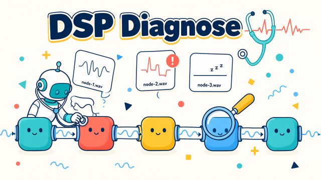

# DSP Diagnose

A native [MicYou](https://github.com/MicYou-Dev/MicYou) DSP plugin that records the audio
each position in the processing chain actually receives. It writes one WAV file per node
with a timestamp name, so a chain problem (wrong order, double processing, silence,
clipping, dropouts) can be located by listening instead of guessing.

```
20261108143205-node-1.wav
20261108143205-node-2.wav
20261108143205-node-3.wav
```



## What it does

- Registers N diagnostic nodes in MicYou's DSP processing chain (`N` = 1..16).
- Every `Plugin:opss.dsp-diagnose` occurrence records only the audio arriving at that
  position. Drag the nodes in **Settings → Audio → Processing chain** to compare any two
  points in the chain.
- Records on a dedicated writer thread; the audio thread only copies samples into a
  lock-free ring buffer.
- Splits long captures into segments (default 30 min) and can record 16/24-bit PCM or
  32-bit float WAV at 48 kHz.
- Keeps the chain in sync: changing the node count adds/removes copies of the node
  without disturbing the order the user arranged.
- Shows a live status table in the plugin panel: files, bytes, dropped samples, current
  and previous file per node.

## Host support

Multiple copies of one plugin in the DSP chain are a MicYou feature introduced by a
host-side multi-node DSP patch (not part of the plugin package). This plugin requires
MicYou **2.1.1 or newer** (`minHostVersion` in `plugin.json`) **and** a host build with
that patch: the patch keeps duplicate `Plugin:<id>` entries and passes the node occurrence
index to `micyou_plugin_process_node`, so every copy records only the audio at its own
position.

Stock MicYou ignores `dsp.allowMultipleNodes` and still collapses duplicates. The
plugin detects this at runtime: it keeps recording node 1, publishes
`chainOk: false` / `hostMultiNode: false`, and its panel warns that only one node is
active. `minHostVersion` cannot express "patched build", so the runtime check is the
authoritative one.

## Install

1. Download `plugin.zip` from [Releases](https://github.com/OrientCOMPASS/DSP-Diagnose/releases).
2. MicYou → Settings → Plugins → install the zip.
3. Enable **DSP Diagnose**, open its panel, choose the node count and output directory.

Default output is `<home>/Music/MicYou DSP Diagnose`; `~/…` is expanded and the directory
is created on the first write.

## Panel

- **Node count** – number of chain nodes to maintain.
- **Node layout** – per-node name and a record on/off switch.
- **Capture settings** – output directory, segment length (`0` = never split), bit depth,
  auto start.
- **Apply** / **Apply nodes to chain** – persist settings and reconcile the chain. The
  chain action waits for the debounced save, so it cannot apply a stale node count.
- **Verify chain** – re-read the chain and report how many copies the host kept.
- **Start** / **Stop** – manual recording control.

The panel polls the `status` config value once per second. It follows the host theme
(the host injects HSL tokens; the panel uses `hsl(var(--token))`), the host UI locale
through the bridge `locale` API, and the host `color-scheme`. Status distinguishes
"not checked yet", "chain ready", "chain incomplete" and "host deduplicates nodes"
instead of guessing multi-node support when only one node was requested.

## Build

CI builds and tests every push. Artifacts are assembled by
[`release.yml`](https://github.com/OrientCOMPASS/DSP-Diagnose/blob/main/.github/workflows/release.yml):

| Platform | Artifact |
| --- | --- |
| Windows x86_64 | `dsp_diagnose.dll` |
| Linux x86_64 | `dsp_diagnose.so` |
| macOS universal (x86_64 + arm64) | `dsp_diagnose.dylib` |

To reproduce locally:

```bash
cargo test
cargo build --release
# rename libdsp_diagnose.so / libdsp_diagnose.dylib to remove the lib prefix
```

Native artifacts must use the manifest's `entry` base name (`dsp_diagnose`) and the
platform suffix, without a `lib` prefix.

## Notes

- The plugin never allocates, locks or calls the host from the audio callback. If the
  writer falls behind, the ring drops samples and the panel reports the count.
- Recording starts when enabled (`autoStart`, default true) and after every host restart.
- The manifest intentionally has no `author` field.
- License: [Unlicense](LICENSE) (public domain).
