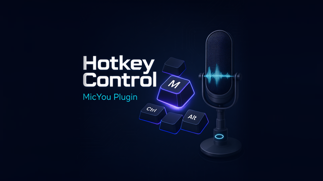

# ⌨️ 快捷键控制 — Hotkey Control for MicYou



> System-wide hotkeys to control MicYou: toggle mute / monitoring, plus true push-to-talk and push-to-mute — on Windows, macOS and Linux (X11 **and** Wayland).

[MicYou](https://github.com/MicYou-Dev/MicYou) 的原生插件（`opss.hotkey`）。用**全局快捷键**直接控制宿主：

| 动作 | 触发方式 | 默认绑定 |
| --- | --- | --- |
| 🔇 切换静音 | 按一次翻转 | `ctrl+alt+m` |
| 🎧 切换耳返监听 | 按一次翻转 | `ctrl+alt+e` |
| 🎙️ 按住说话 Push-to-Talk | 按住取消静音，松开恢复 | 未绑定（自行录入） |
| 🤫 按住静音 Push-to-Mute | 按住强制静音，松开恢复 | 未绑定（自行录入） |

组合键**完全自定义**：修饰键 `ctrl/alt/shift/win`（或区分左右的 `lctrl/rctrl/…`）＋
主键（字母/数字/`f1`–`f24`/方向键/标点），也支持**纯修饰键组合**（如 `lctrl+lshift`）
和**鼠标侧键**（`mouse4` 后退 / `mouse5` 前进）。设置面板内置「按键捕获」，
按下目标组合即所见即所得地录入，无需手写字符串。

## 安装

1. 下载 [Release](https://github.com/OrientCOMPASS/MicYou-Hotkey/releases) 的 `plugin.zip`
   （单包携带三平台产物 `micyou_hotkey.{dll,so,dylib}`，宿主按平台自选；
   push 触发的 Actions artifact `opss.hotkey-v<版本>-development` 为未发布构建）；
2. MicYou「设置 → 插件」安装该 zip，启用「快捷键控制」。

安装目录结构：

```text
opss.hotkey/
├── plugin.json            # 清单（apiVersion 2 / native）
├── micyou_hotkey.dll      # Windows x86_64
├── micyou_hotkey.so       # Linux x86_64
├── micyou_hotkey.dylib    # macOS aarch64 (Apple Silicon)
├── panel.html             # 设置面板（状态 + 按键捕获）
├── README.md
└── LICENSE
```

## 使用

打开「设置 → 插件 → 快捷键设置」面板：

* **状态卡**：实时显示捕获引擎（`Windows 钩子` / `macOS 事件tap` / `Linux evdev` /
  `宿主快捷键(降级)` / `不可用`）与诊断详情，以及静音 / 耳返 / PTT 按住中 / PTM 按住中
  四个实时指示灯；总开关可一键停用全部绑定。
* **按键绑定**：每行一个动作。点「按键捕获」→ 直接按下目标组合（或点击鼠标侧键）→
  预览实时成形 → 点「使用该组合」保存（立即生效，无需重启）。「清除」停用该绑定；
  「测试」通过宿主消息链路模拟一次触发，用于验证控制面而不必真按键。
* **校验规则**（与插件内核一致，捕获时即时提示）：
  * 字母/数字/普通键作主键时**必须搭配修饰键**；
  * 纯修饰键组合**至少两个**修饰键（避免误触）；
  * 无修饰键时仅支持 `f1`–`f24` 与 `mouse4`/`mouse5`。
* **PTT/PTM 语义**：按下瞬间记录基线状态——PTT 仅在当前已静音时取消静音，
  松开恢复静音（原本未静音则按键不影响状态，天然防呆）；PTM 相反。
  自动重复（按住产生的连发 down 事件）不会破坏恢复逻辑。
* **系统通知**（可选项）：切换静音/耳返时弹通知（PTT/PTM 不弹，避免刷屏）。

所有配置也暴露在宿主的通用 configSchema 表单里（可直接手填组合键字符串），
与面板双向一致。

## 平台支持与权限

| 平台 | 捕获后端 | 按住类绑定 (PTT/PTM) | 吞掉热键击键 | 前置条件 |
| --- | --- | --- | --- | --- |
| Windows x86_64 | `WH_KEYBOARD_LL` + `WH_MOUSE_LL` 低级钩子 | ✅ | ✅（主键；修饰键按下期间） | 无（前台程序以管理员运行而 MicYou 未提权时收不到其按键，UIPI 限制） |
| macOS aarch64 | `CGEventTap`（会话级事件 tap） | ✅ | ✅（同左策略） | **辅助功能权限**：系统设置 → 隐私与安全性 → 辅助功能 → 勾选 MicYou，重启 MicYou |
| Linux x86_64 | 内核 evdev（`/dev/input/event*`） | ✅ | ❌（原始 tap 仅观察） | 桌面会话通常开箱即用（logind uaccess）；SSH 等环境把用户加入 `input` 组后重新登录 |

* **架构**：zip 内每个平台仅一个二进制——Linux 仅 x86_64、macOS 仅 aarch64
  （宿主按扩展名解析 entry，同扩展名多架构无法共存于一个包）。
  arm Linux 与 Intel Mac 暂不提供产物。
* **macOS 未授权辅助功能**时自动降级为「仅监听 tap」（热键仍工作，但按键不吞）；
  完全无法建 tap 时降级为宿主快捷键（见下）。
* **Linux 按键不被吞掉**：热键击键会同时传给前台应用。建议 Linux 上使用
  鼠标侧键、`f13`+ 或纯修饰键组合（前台应用基本不消费这类按键），
  面板会在 evdev 引擎下显示此提示。

### 降级模式（宿主快捷键）

原生捕获不可用时（无权限、无 `/dev/input`、钩子安装失败），插件回退到宿主的
`register_hotkey` 注册**两个切换类绑定**（mute/monitor）——该 API 仅 X11 有效、
只有按下事件，因此 **PTT/PTM 在降级模式下不生效**，面板状态卡会显示
「降级模式」徽标与各绑定的实际生效情况。Wayland 桌面下宿主快捷键同样不可用，
此时 evdev 后端正是主力（Linux 无需降级）。

## 为什么不用宿主的 register_hotkey？

宿主的 `register_hotkey` 基于 X11 grab：**Wayland 无效、无按键释放事件、
不支持纯修饰键与鼠标侧键**——Push-to-Talk 这类「按住/松开」语义根本做不了。
本插件与 [MicYou-Voice-Typing](https://github.com/OrientCOMPASS/MicYou-Voice-Typing)
同路线：自带平台原生输入捕获（Windows 低级钩子 / macOS 事件 tap / Linux evdev），
把「按键事件」翻译成宿主控制面 API v2 调用（`set_muted` / `set_monitoring`），
并通过 `mute_changed` / `monitoring_changed` 事件回读保持状态一致。
实现细节见 [docs/TECHNICAL.md](docs/TECHNICAL.md)。

## 从源码构建

```bash
cargo test --release                    # 25 个单元测试（组合键解析/动作状态机/平台映射）
cargo build --release                   # 插件 cdylib（target/release/libmicyou_hotkey.{so,dylib} / micyou_hotkey.dll）
bash scripts/package.sh                 # 本地打包 dist/plugin-local.zip
                                        #   Linux .so 原生 + Windows .dll（装 mingw-w64 后可交叉编译：
                                        #   cargo build --release --target x86_64-pc-windows-gnu）
```

无需任何系统库依赖：Linux 捕获用纯 Rust 的 `evdev` crate，macOS 直接 `extern "C"`
链系统框架，Windows 用 `windows` crate。三平台 CI 见
[.github/workflows/release.yml](.github/workflows/release.yml)
（push → 三平台构建 + 单测 → development artifact；workflow_dispatch → 打 tag 发 Release）。
与真实宿主的控制面联调（生命周期 / 事件同步 / 降级路径）需安装进 MicYou 验证，
见 [docs/TECHNICAL.md §9](docs/TECHNICAL.md)。

## 许可

Unlicense（公有领域），见 [LICENSE](LICENSE)。
